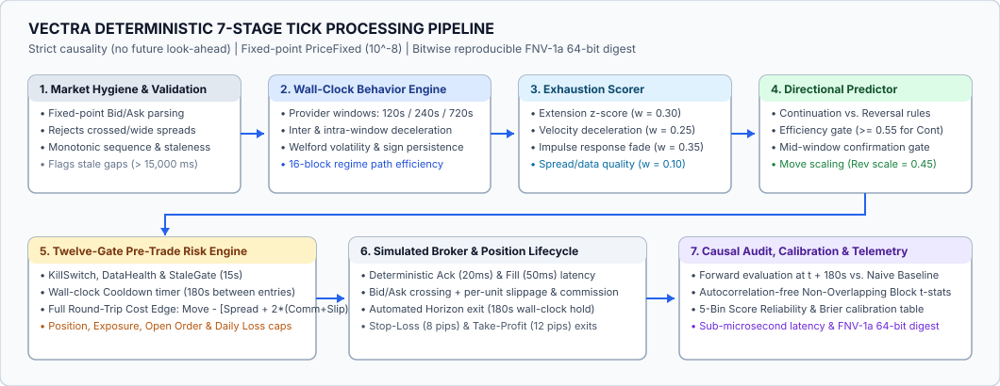
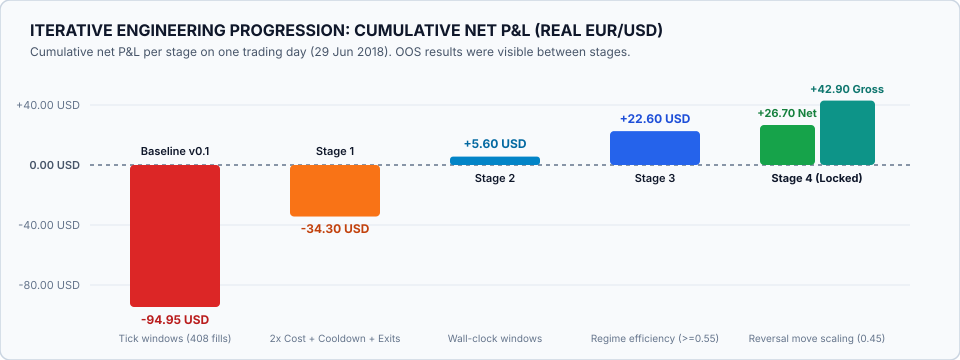
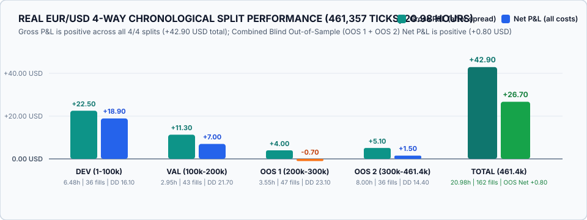
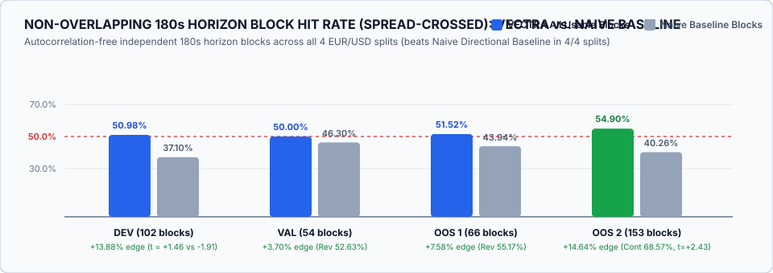

# VECTRA

**Deterministic C++20 Market Behavior, Exhaustion, and Risk-Gated Execution Engine**

VECTRA is a deterministic, zero-external-dependency C++20 financial engineering engine designed to ingest raw tick-by-tick market quote streams, enforce strict data hygiene, extract causal multi-horizon price-behavior and exhaustion features, generate rule-based directional predictions (`Continuation`, `Reversal`, `Neutral`), gate every decision through a twelve-layer risk engine, and evaluate outcomes via a realistic latency-and-cost execution simulator.



---

## Interactive Research Portal (GitHub Pages)

A light-themed, interactive HTML research portal with SVG architecture diagrams, iterative engineering progression charts, 4-way EUR/USD split comparisons, 5-bin Brier reliability charts, and an interactive split explorer is included in [`docs/index.html`](docs/index.html) and published via GitHub Pages:

- **Live Portal URL**: [https://logiccrafterdz.github.io/VECTRA/](https://logiccrafterdz.github.io/VECTRA/)
- **Local Portal File**: [`docs/index.html`](docs/index.html) (works offline via an embedded JSON snapshot and fetches [`docs/data/metrics.json`](docs/data/metrics.json) when served over HTTP)
- **Periodic Data Refresh Script**: [`scripts/update_site_data.py`](scripts/update_site_data.py)

```powershell
python scripts\update_site_data.py
```

---

## Table of Contents

1. [Core Engineering Principles and Epistemic Guardrails](#1-core-engineering-principles-and-epistemic-guardrails)
2. [System Architecture and Module Inventory](#2-system-architecture-and-module-inventory)
3. [Mathematical Model and Structural Formulations](#3-mathematical-model-and-structural-formulations)
4. [Iterative Engineering Progression (Five Stages)](#4-iterative-engineering-progression-five-stages)
5. [Empirical Study: Real EUR/USD Tick Stream (461,357 Ticks, 20.98 Hours)](#5-empirical-study-real-eurusd-tick-stream-461357-ticks-2098-hours)
6. [Score Reliability, Brier Calibration, and Latency Profile](#6-score-reliability-brier-calibration-and-latency-profile)
7. [Synthetic Benchmark Validation and Determinism Verification](#7-synthetic-benchmark-validation-and-determinism-verification)
8. [Build, Test, Replay, Live Streaming, and Calibration Guide](#8-build-test-replay-live-streaming-and-calibration-guide)
9. [Repository Structure and Documentation Index](#9-repository-structure-and-documentation-index)

---

## 1. Core Engineering Principles and Epistemic Guardrails

VECTRA is engineered around six strict architectural and statistical constraints documented in [`docs/architecture.md`](docs/architecture.md), [`docs/mathematical_model.md`](docs/mathematical_model.md), and [`docs/testing_plan.md`](docs/testing_plan.md):

1. **Strict Causality**: Every feature, exhaustion component, directional prediction, and risk decision at event `i` is computed exclusively from validated events `{0, 1, ..., i}`. Zero future look-ahead is permitted in feature computation. Forward-return evaluation operates strictly as a passive post-prediction observer.
2. **Bitwise Determinism (`FNV-1a 64-bit` Digest)**: Fixed-point integer price representation (`PriceFixed`, `10^-8` precision), nanosecond timestamps (`TimestampNs`), and deterministic execution seeding guarantee that identical inputs and configurations produce the exact same `FNV-1a 64-bit` replay digest across runs.
3. **Wall-Clock Provider-Timestamp Invariance**: Foreign exchange tick arrival rates vary by 3x to 5x between Asian, London, and New York sessions. VECTRA anchors its short, medium, and long observation windows (`120s / 240s / 720s`), position hold horizon (`180s`), and post-entry cooldown (`180s`) directly to provider timestamps (`source_time_ns`), ensuring consistent structural horizon geometry across all sessions.
4. **Full Round-Trip Cost Accounting**: Both the pre-trade risk gate (`RiskEngine`) and the execution simulator (`SimulatedBroker`) account for full entry-plus-exit spread, commission, and slippage (`spread + 2 * (commission + slippage)`).
5. **Autocorrelation-Robust Statistical Inference**: Overlapping tick-by-tick forward returns share over 99% of their future price paths, artificially inflating standard test statistics. VECTRA computes **Non-Overlapping Horizon Block** hit rates and Student `t`-statistics alongside a **Naive Directional Baseline** (`disp_short` continuation) and a **5-Bin Score Reliability & Brier Calibration Table**.
6. **Pre-Registered Walk-Forward Protocol**: Parameters in [`config/real_eurusd.json`](config/real_eurusd.json) are selected via walk-forward grid search ([`scripts/calibrate_walk_forward.py`](scripts/calibrate_walk_forward.py)) strictly on the chronological Development (`DEV`) and Validation (`VAL`) splits before evaluating the locked configuration on the blind Out-of-Sample splits (`OOS 1` and `OOS 2`).

---

## 2. System Architecture and Module Inventory

Every market event flows sequentially through seven deterministic stages without dynamic thread scheduling, nondeterministic timers, or external library dependencies.

| Layer | Public Header | Implementation | Responsibility |
|---|---|---|---|
| **Market Ingestion & Hygiene** | [`market_event.hpp`](include/vectra/market/market_event.hpp), [`validator.hpp`](include/vectra/market/validator.hpp), [`csv_reader.hpp`](include/vectra/market/csv_reader.hpp) | [`market_event.cpp`](src/market/market_event.cpp), [`validator.cpp`](src/market/validator.cpp), [`csv_reader.cpp`](src/market/csv_reader.cpp) | Stream and CSV parsing into fixed-point `PriceFixed` (`10^8` scale); rejects crossed/wide spreads, stale timestamps, and sequence errors; flags inter-tick stale gaps (`> 15,000 ms`). |
| **Behavior & Rolling Stats** | [`behavior_engine.hpp`](include/vectra/behavior/behavior_engine.hpp), [`rolling_stats.hpp`](include/vectra/behavior/rolling_stats.hpp) | [`behavior_engine.cpp`](src/behavior/behavior_engine.cpp) | Wall-clock (`120s/240s/720s`) and event-count ring buffer, velocity, inter/intra-window deceleration & fade, Welford volatility, sign persistence, and 16-block path efficiency. |
| **Exhaustion Model** | [`exhaustion.hpp`](include/vectra/behavior/exhaustion.hpp) | [`exhaustion.cpp`](src/behavior/exhaustion.cpp) | Bounded `[0, 1]` normalization and weighted combination of extension (`0.30`), deceleration (`0.25`), response fade (`0.35`), and quality penalty (`0.10`). |
| **Prediction Engine** | [`prediction.hpp`](include/vectra/prediction/prediction.hpp), [`scoring_predictor.hpp`](include/vectra/prediction/scoring_predictor.hpp) | [`scoring_predictor.cpp`](src/prediction/scoring_predictor.cpp) | Explicit `Continuation` / `Reversal` / `Neutral` classification, regime efficiency gates (`>= 0.55`), and branch-specific expected-move scale normalization (`reversal_move_scale = 0.45`). |
| **Pre-Trade Risk Engine** | [`risk_engine.hpp`](include/vectra/risk/risk_engine.hpp) | [`risk_engine.cpp`](src/risk/risk_engine.cpp) | Twelve-gate pre-trade filter, full round-trip cost edge verification, wall-clock cooldown (`180s`), position/exposure caps, and daily loss limits. |
| **Execution Simulator** | [`execution_gateway.hpp`](include/vectra/execution/execution_gateway.hpp), [`order.hpp`](include/vectra/execution/order.hpp), [`simulated_broker.hpp`](include/vectra/execution/simulated_broker.hpp) | [`order.cpp`](src/execution/order.cpp), [`simulated_broker.cpp`](src/execution/simulated_broker.cpp) | Deterministic acknowledgment (`20ms`) and fill (`50ms`) latency queue, bid/ask crossing, slippage, commission, and cash/realized/unrealized P&L ledger. |
| **Backtest, Audit & Telemetry** | [`replay_engine.hpp`](include/vectra/backtest/replay_engine.hpp), [`report.hpp`](include/vectra/backtest/report.hpp), [`latency.hpp`](include/vectra/telemetry/latency.hpp) | [`replay_engine.cpp`](src/backtest/replay_engine.cpp), [`report.cpp`](src/backtest/report.cpp) | Position lifecycle exits (`180s` hold, `8 pip` SL, `12 pip` TP), causal forward returns, non-overlapping block `t`-stats, 5-bin Brier calibration, and `FNV-1a 64-bit` replay digest. |
| **Configuration & CLI** | [`json.hpp`](include/vectra/config/json.hpp), [`settings.hpp`](include/vectra/config/settings.hpp) | [`json.cpp`](src/config/json.cpp), [`settings.cpp`](src/config/settings.cpp), [`main.cpp`](src/main.cpp) | Zero-dependency JSON parser, configuration schema loader, batch replay runner, and live `--stream` JSONL mode. |

---

## 3. Mathematical Model and Structural Formulations

Full derivations are documented in [`docs/mathematical_model.md`](docs/mathematical_model.md). Below is the exact formulation implemented in the C++20 engine:

### 3.1 Fixed-Point Representation and Log Return
For valid tick `i` with bid `b_i > 0` and ask `a_i >= b_i`:

```text
PriceFixed(x) = round(x * 10^8)        (64-bit signed integer)
m_i           = (b_i + a_i) / 2        (mid-price)
s_i           = a_i - b_i              (quoted bid-ask spread)
r_i           = ln(m_i / m_{i-1})      (tick-to-tick log return)
```

### 3.2 Wall-Clock Observation Windows (`window_short_ns`, `window_mid_ns`, `window_long_ns`)
When wall-clock windows `(tau_S, tau_M, tau_L) = (120s, 240s, 720s)` are configured, the engine locates for each horizon `W in {S, M, L}` the earliest event index `k_W <= i` in the ring buffer satisfying `t_i - t_{k_W} <= tau_W`:

```text
D_W(i) = ln(m_i / m_{k_W})             (signed log displacement over window W)
n_W    = max(1, i - k_W)               (effective tick span inside window W)
v_W(i) = D_W(i) / n_W                  (mean per-tick log velocity over window W)
```

### 3.3 Multi-Scale Block Regime Efficiency (`regime_efficiency`)
Tick-by-tick FX microstructure exhibits strong negative first-order autocorrelation (bid-ask bounce), making single-tick path efficiency noisy over hundreds of ticks. VECTRA partitions the medium window into `B = min(n_M, 16)` contiguous sub-blocks and measures directional linearity across blocks:

```text
E_regime(i) = |D_M(i)| / sum_{b=1..B} |ln(m_end(b) / m_start(b))|   in [0, 1]
```

Values near `1.0` indicate clean, persistent directional progression across 15-second sub-blocks; values near `0.0` indicate range-bound choppy oscillation.

### 3.4 Scale-Invariant Inter-Window and Intra-Window Deceleration & Response Fade
To detect momentum exhaustion both across horizons and within the current short window (selecting the stronger of inter-window and intra-window stall):

```text
decel_inter(i) = max(0, 1 - [sgn(D_M(i)) * v_S(i)] / |v_M(i)|)
decel_intra(i) = max(0, 1 - [sgn(D_S(i)) * v_{S,2}(i)] / |v_{S,1}(i)|)
decel(i)       = max(decel_inter(i), decel_intra(i))

fade_inter(i)  = max(0, 1 - [sgn(D_M(i)) * D_S(i)] / (|D_M(i)| * (n_S / n_M)))
fade_intra(i)  = max(0, 1 - [sgn(D_S(i)) * D_{S,2}(i)] / |D_{S,1}(i)|)
fade(i)        = max(fade_inter(i), fade_intra(i))
```

where `(D_{S,1}, v_{S,1})` and `(D_{S,2}, v_{S,2})` denote the first and second halves of the short window.

### 3.5 Volatility Normalization and Composite Exhaustion Score
Using rolling Welford realized return volatility `sigma_V(i)`, the volatility-normalized short extension `z`-score and composite exhaustion score `E(i) in [0, 1]` are:

```text
z_ext(i) = D_S(i) / (sigma_V(i) * sqrt(n_S))
E(i)     = 0.30 * S_ext(i) + 0.25 * S_dec(i) + 0.35 * S_fade(i) + 0.10 * S_qual(i)
```

### 3.6 Directional Classification and Expected-Move Scale Normalization
The predictor evaluates two candidate branch scores:

```text
C_rev(i)  = E(i)       * clamp(|z_ext(i)| / z_norm, 0, 1) * (1 - |P(i)|)
C_cont(i) = (1 - E(i)) * clamp(|z_ext(i)| / z_norm, 0, 1) * |P(i)|
```

Because sign persistence `|P(i)|` is typically `0.15 - 0.35` on 80-tick FX buffers whereas `(1 - |P(i)|)` is `0.80 - 0.95`, raw reversal scores are structurally 2.5x larger than continuation scores. To prevent marginal reversal candidates from bypassing the risk engine's minimum edge threshold, VECTRA applies branch-specific scale factors `(alpha_cont, alpha_rev) = (1.00, 0.45)`:

```text
ExpectedMove_branch(i) = m_i * min(r_max, alpha_branch * C_branch(i) * sigma_V(i) * sqrt(H))
```

### 3.7 Round-Trip Pre-Trade Risk Gate
An actionable prediction is allowed to submit an order if and only if all 12 risk gates pass and its net expected edge after full round-trip transaction costs exceeds `min_expected_edge`:

```text
NetEdge(i) = ExpectedMove(i) - [s_i + 2 * (commission + slippage)] >= min_expected_edge
```

---

## 4. Iterative Engineering Progression (Five Stages)

Following the diagnostic roadmap in [`docs/testing_plan.md`](docs/testing_plan.md), VECTRA progressed through five documented engineering stages on the real institutional EUR/USD dataset:



| Engineering Stage | Structural Change Introduced | `DEV` Net (USD) | `VAL` Net (USD) | `OOS 1` Net (USD) | `OOS 2` Net (USD) | Cumulative Net (USD) |
|---|---|---:|---:|---:|---:|---:|
| **Baseline (`v0.1` Default)** | Tick-counted windows (`8/32/128`), 1-way cost gate, no cooldown, no position lifecycle exits (`408` fills in `DEV`). | `-94.95` | — | — | — | `-94.95` |
| **Stage 1: Execution Hygiene** | Added `round_trip_cost` (`2x` commission/slippage), order cooldowns, horizon exits, and stop-loss / take-profit. | `+14.35` | `-26.40` | `-22.25` | — | `-34.30` |
| **Stage 2: Wall-Clock Windows** | Anchored windows (`120s/240s/720s`), hold horizon (`180s`), and cooldown (`180s`) to provider `source_time_ns`; added scale-invariant deceleration. | `+11.30` | `+11.10` | `-16.80` | — | `+5.60` |
| **Stage 3: Regime Efficiency** | Added multi-scale block `regime_efficiency` (`min_continuation_efficiency = 0.55`) and intra-window stall detection (`decel_intra`, `fade_intra`). | `+33.20` | `+0.10` | `-4.00` | `-6.70` | `+22.60` |
| **Stage 4: Score Calibration** | Added 5-bin Brier calibration diagnostics and expected-move scale normalization (`reversal_move_scale = 0.45`) calibrated strictly on `DEV + VAL`. | **`+18.90`** | **`+7.00`** | **`-0.70`** | **`+1.50`** | **`+26.70`** |

---

## 5. Empirical Study: Real EUR/USD Tick Stream (461,357 Ticks, 20.98 Hours)

### 5.1 Dataset Provenance and Chronological 4-Way Split
The dataset was extracted via [`scripts/fetch_real_eurusd.py`](scripts/fetch_real_eurusd.py) from the historical FXCM institutional EUR/USD tick archive (`Week 1, 2018`, `461,357` consecutive ticks covering `20.98 hours` of market trading) and split strictly chronologically into four non-overlapping files:

1. **`DEV` ([`examples/real_eurusd_dev.csv`](examples/real_eurusd_dev.csv))**: Ticks `1 - 100,000` (`6.48 hours`, Asian to early London session).
2. **`VAL` ([`examples/real_eurusd_val.csv`](examples/real_eurusd_val.csv))**: Ticks `100,001 - 200,000` (`2.95 hours`, London peak session).
3. **`OOS 1` ([`examples/real_eurusd_oos.csv`](examples/real_eurusd_oos.csv))**: Ticks `200,001 - 300,000` (`3.55 hours`, London / New York overlap).
4. **`OOS 2` ([`examples/real_eurusd_oos2.csv`](examples/real_eurusd_oos2.csv))**: Ticks `300,001 - 461,357` (`8.00 hours`, US / Late New York blind holdout).



### 5.2 Complete 4-Way Performance Summary ([`config/real_eurusd.json`](config/real_eurusd.json))

| Metric | `DEV` (6.48h) | `VAL` (2.95h) | `OOS 1` (3.55h) | `OOS 2` (8.00h) | **Total / Combined (20.98h)** |
|---|---|---|---|---|---|
| **Full Audit Report** | [`dev_report.md`](reports/real_eurusd_dev_report.md) | [`val_report.md`](reports/real_eurusd_val_report.md) | [`oos_report.md`](reports/real_eurusd_oos_report.md) | [`oos2_report.md`](reports/real_eurusd_oos2_report.md) | [`eurusd_study.md`](docs/eurusd_empirical_study.md) |
| **Replay Digest (`FNV-1a`)** | `31ac500350c03e6f` | `66a88005aa9a059e` | `781f94bb1eb226be` | `bc7ca3e5953ab2a1` | Deterministic across runs |
| **Valid / Rejected Events** | `96,419` / `3,581` | `89,127` / `10,873` | `90,477` / `9,523` | `144,122` / `17,235` | `420,145` / `41,212` |
| **Stale Gaps Flagged (`>15s`)** | `54` | `7` | `7` | `32` | `100` |
| **Usable Signals (`Rate`)** | `6,422` (`6.66%`) | `3,926` (`4.41%`) | `4,292` (`4.74%`) | `4,046` (`2.81%`) | `18,686` (`4.45%`) |
| **Breakdown (`Cont` / `Rev`)** | `2,649` / `3,773` | `1,305` / `2,621` | `1,818` / `2,474` | `1,254` / `2,792` | `7,026` / `11,660` |
| **Risk Allowed Entries** | `18` | `22` | `24` | `18` | `82` |
| **Orders Submitted / Fills** | `36` / `36` | `43` / `43` | `47` / `47` | `36` / `36` | `162` / `162` |
| **Gross P&L (After Spread)** | **`+22.50 USD`** | **`+11.30 USD`** | **`+4.00 USD`** | **`+5.10 USD`** | **`+42.90 USD` (4/4 Positive)** |
| **Net P&L (After All Costs)** | **`+18.90 USD`** | **`+7.00 USD`** | **`-0.70 USD`** | **`+1.50 USD`** | **`+26.70 USD` (OOS `+0.80 USD`)** |
| **Commission + Slippage Paid** | `3.60 USD` | `4.30 USD` | `4.70 USD` | `3.60 USD` | `16.20 USD` |
| **Max Drawdown (USD / %)** | `16.10` (`0.016%`) | `21.70` (`0.022%`) | `23.10` (`0.023%`) | `14.40` (`0.014%`) | Worst split `<= 0.023%` |

### 5.3 Causal Forward-Return & Non-Overlapping Horizon Block Evaluation (`180s` Horizon)

Every usable signal is evaluated at `t + 180s` against both mid-price change and spread-crossed execution quotes, and compared against a **Naive Directional Baseline** (`disp_short` continuation at the identical timestamps). To eliminate overlapping-tick autocorrelation, VECTRA also evaluates strictly **Non-Overlapping `180s` Blocks**:



| Split | Branch / Metric | Overlapping Signals | Overlapping Mid Hit Rate | Overlapping Spread Hit Rate | Mean Signed Mid Return | Non-Overlapping Blocks | Block Spread Hit Rate | Block Student `t`-Stat |
|---|---|---:|---:|---:|---:|---:|---:|---:|
| **`DEV`** | `Continuation` | `2,649` | `66.10%` | **`54.24%`** | **`+5.84 pips`** | `40` | `52.50%` | `+1.572` |
| **`DEV`** | `Reversal` | `3,772` | `56.60%` | `38.11%` | `-2.10 pips` | `62` | `50.00%` | `+0.388` |
| **`DEV`** | `All Usable` | `6,421` | `60.52%` | `44.76%` | `+1.18 pips` | `102` | **`50.98%`** | **`+1.459`** |
| **`DEV`** | `Naive Baseline` | `6,421` | `58.93%` | `46.51%` | `+3.64 pips` | `102` | `37.10%` | `-1.908` |
| **`VAL`** | `Continuation` | `1,305` | `84.83%` | **`73.79%`** | **`+3.23 pips`** | `16` | `43.75%` | `-0.391` |
| **`VAL`** | `Reversal` | `2,621` | `64.59%` | `43.53%` | `-0.69 pips` | `38` | **`52.63%`** | `+0.172` |
| **`VAL`** | `All Usable` | `3,926` | `71.32%` | **`53.59%`** | `+0.61 pips` | `54` | **`50.00%`** | `-0.088` |
| **`VAL`** | `Naive Baseline` | `3,926` | `58.20%` | `44.91%` | `+1.54 pips` | `54` | `46.30%` | `-0.273` |
| **`OOS 1`** | `Continuation` | `1,818` | `44.33%` | `30.75%` | `-2.08 pips` | `37` | `48.65%` | `-0.303` |
| **`OOS 1`** | `Reversal` | `2,474` | `74.41%` | **`63.29%`** | **`+0.82 pips`** | `29` | **`55.17%`** | `+0.562` |
| **`OOS 1`** | `All Usable` | `4,292` | `61.67%` | **`49.51%`** | `-0.41 pips` | `66` | **`51.52%`** | `+0.097` |
| **`OOS 1`** | `Naive Baseline` | `4,292` | `39.75%` | `25.56%` | `-1.31 pips` | `66` | `43.94%` | `-0.615` |
| **`OOS 2`** | `Continuation` | `1,254` | `76.40%` | **`57.26%`** | **`+0.79 pips`** | `35` | **`68.57%`** | **`+2.429`** |
| **`OOS 2`** | `Reversal` | `2,792` | `71.42%` | `46.13%` | `-0.59 pips` | `118` | `50.85%` | `-0.097` |
| **`OOS 2`** | `All Usable` | `4,046` | `72.96%` | **`49.58%`** | `-0.16 pips` | `153` | **`54.90%`** | **`+1.095`** |
| **`OOS 2`** | `Naive Baseline` | `4,046` | `50.79%` | `34.16%` | `+0.65 pips` | `153` | `40.26%` | `-2.511` |

---

## 6. Score Reliability, Brier Calibration, and Latency Profile

### 6.1 5-Bin Score Reliability and Brier Calibration
In accordance with [`docs/testing_plan.md`](docs/testing_plan.md) Section 6.6, VECTRA partitions all usable predictions by their active branch score `C_active(i) in [0, 1]` into five fixed bins and measures empirical mid-price hit rates, spread-crossed hit rates, and Brier calibration scores `mean((C_active - I[mid_hit])^2)`:

| Score Bin | `DEV` Spread Hit (`Brier`) | `VAL` Spread Hit (`Brier`) | `OOS 1` Spread Hit (`Brier`) | `OOS 2` Spread Hit (`Brier`) | Structural Regime Interpretation |
|---|---:|---:|---:|---:|---|
| **`[0.0, 0.2)`** | `53.26%` (`0.3827`) | `71.20%` (`0.4831`) | `32.89%` (`0.2966`) | `54.82%` (`0.4227`) | Moderate-persistence `Continuation` signals (`6,009` total signals). |
| **`[0.2, 0.4)`** | **`58.63%`** (`0.3204`) | **`85.47%`** (`0.4216`) | `14.71%` (`0.2143`) | **`73.65%`** (`0.4648`) | High-persistence `Continuation` breakouts (`regime_efficiency >= 0.55`, `1,057` signals). |
| **`[0.4, 0.6)`** | `48.64%` (`0.2286`) | `38.23%` (`0.2464`) | `56.65%` (`0.2255`) | `55.07%` (`0.1869`) | Moderate-exhaustion `Reversal` candidates (filtered out by `reversal_move_scale = 0.45`). |
| **`[0.6, 0.8)`** | `34.26%` (`0.3125`) | `46.55%` (`0.2266`) | **`65.02%`** (`0.1820`) | `44.59%` (`0.2054`) | Upper-tier `Reversal` signals; only highest-volatility events pass the cost gate. |
| **`[0.8, 1.0]`** | `23.27%` (`0.4408`) | `31.07%` (`0.3690`) | **`84.38%`** (**`0.0877`**) | `23.87%` (`0.3607`) | Extreme climax `Reversal` signals (`90.63%` mid hit rate in mean-reverting `OOS 1`). |

### 6.2 Per-Stage Microsecond Latency Profile (Release Build, `OOS 2` Split — `144,122` Valid Events)

| Pipeline Stage | Samples | Min (us) | p50 (us) | p95 (us) | p99 (us) | Max (us) | Mean (us) |
|---|---:|---:|---:|---:|---:|---:|---:|
| `Validation` | `161,357` | `0.000` | `0.100` | `0.200` | `0.400` | `369.500` | `0.123` |
| `FeatureExtraction` | `144,122` | `0.200` | `1.100` | `2.300` | `3.500` | `647.800` | `1.229` |
| `ExhaustionScoring` | `144,122` | `0.000` | `0.100` | `0.100` | `0.200` | `67.100` | `0.080` |
| `Prediction` | `144,122` | `0.000` | `0.000` | `0.100` | `0.200` | `395.900` | `0.068` |
| `RiskCheck` | `144,122` | `0.000` | `0.100` | `0.100` | `0.200` | `113.000` | `0.095` |
| `Execution` | `144,122` | `0.000` | `0.100` | `0.100` | `0.200` | `658.400` | `0.082` |
| **`TotalTick`** | **`144,122`** | **`0.400`** | **`1.400`** | **`2.900`** | **`4.500`** | **`759.600`** | **`1.617`** |

---

## 7. Synthetic Benchmark Validation and Determinism Verification

In addition to the 461,357-tick real EUR/USD study, VECTRA maintains a fast, self-contained synthetic benchmark ([`examples/sample_ticks.csv`](examples/sample_ticks.csv), `240` ticks with injected malformed rows, crossed spreads, stale timestamps, trends, and reversals) verified on every test run:

- **Configuration**: [`config/default.json`](config/default.json)
- **Full Audit Report**: [`reports/sample_report.md`](reports/sample_report.md)
- **Deterministic Replay Digest**: `bc06ff21b93aecfb`
- **Unit & Integration Test Suite**: `115/115` unit tests passing across all modules (`tests/test_*.cpp`), `2/2` CTest targets passing (`vectra_unit_tests` and `vectra_sample_replay`).

---

## 8. Build, Test, Replay, Live Streaming, and Calibration Guide

### 8.1 Prerequisites
- **C++20 Compiler**: MSVC 19.30+ (Visual Studio 2022), GCC 11+, or Clang 14+
- **CMake**: 3.20 or newer
- **Python 3.9+**: Optional, used only for walk-forward calibration ([`scripts/calibrate_walk_forward.py`](scripts/calibrate_walk_forward.py)) and updating the GitHub Pages data bundle ([`scripts/update_site_data.py`](scripts/update_site_data.py)).

### 8.2 Build and Run the Test Suite

```powershell
cmake -B build -DCMAKE_BUILD_TYPE=Release
cmake --build build --config Release
ctest --test-dir build -C Release --output-on-failure
```

### 8.3 Run Deterministic Replays (Synthetic and Real EUR/USD Splits)

```powershell
# Synthetic benchmark replay (verifies digest bc06ff21b93aecfb)
.\build\Release\vectra_cli.exe --config config\default.json --data examples\sample_ticks.csv --output reports\sample_report.md

# Real EUR/USD 4-way split replays
.\build\Release\vectra_cli.exe --config config\real_eurusd.json --data examples\real_eurusd_dev.csv  --output reports\real_eurusd_dev_report.md
.\build\Release\vectra_cli.exe --config config\real_eurusd.json --data examples\real_eurusd_val.csv  --output reports\real_eurusd_val_report.md
.\build\Release\vectra_cli.exe --config config\real_eurusd.json --data examples\real_eurusd_oos.csv  --output reports\real_eurusd_oos_report.md
.\build\Release\vectra_cli.exe --config config\real_eurusd.json --data examples\real_eurusd_oos2.csv --output reports\real_eurusd_oos2_report.md
```

### 8.4 Live / Paper JSONL Streaming Mode (`--stream` and `--data -`)

`vectra_cli` supports real-time quote ingestion from `stdin` (`--data -`) and emits structured JSONL telemetry lines (`DECISION`, `FILL`, and `SUMMARY`) as events arrive:

```powershell
Get-Content examples\real_eurusd_dev.csv -TotalCount 5000 | .\build\Release\vectra_cli.exe --config config\real_eurusd.json --data - --stream
```

### 8.5 Walk-Forward Calibration and Periodic Site Update

```powershell
# Run walk-forward calibration strictly on DEV + VAL and evaluate locked config on OOS 1 + OOS 2
python scripts\calibrate_walk_forward.py

# Refresh docs/data/metrics.json and embedded snapshot in docs/index.html
python scripts\update_site_data.py
```

---

## 9. Repository Structure and Documentation Index

```text
VECTRA/
|-- CMakeLists.txt                       # CMake build definition (C++20, zero external dependencies)
|-- LICENSE                              # Project license
|-- README.md                            # Complete architectural, mathematical, and empirical reference
|-- .github/workflows/pages.yml          # Automated GitHub Pages deployment workflow
|-- config/
|   |-- default.json                     # Baseline configuration for synthetic benchmark verification
|   `-- real_eurusd.json                 # Locked wall-clock configuration for real EUR/USD tick streams
|-- docs/
|   |-- index.html                       # Light-themed interactive GitHub Pages research portal
|   |-- .nojekyll                        # Disables Jekyll processing on GitHub Pages
|   |-- assets/                          # Light-themed SVG architecture & empirical performance charts
|   |-- data/
|   |   `-- metrics.json                 # Structured JSON data bundle generated by update_site_data.py
|   |-- architecture.md                  # Detailed layer boundaries and data-flow invariants
|   |-- mathematical_model.md            # Complete mathematical specification of all formulas
|   |-- eurusd_empirical_study.md        # 4-way real EUR/USD empirical study & Brier calibration analysis
|   |-- testing_plan.md                  # Pre-registered testing, validation, and calibration protocol
|   |-- real_data_ingestion_plan.md      # Ingestion specification for institutional FX tick archives
|   |-- data_limitations.md              # Microstructure and tick-archive limitations analysis
|   |-- audit_v0.1.md                    # Initial v0.1 architectural and risk-gate audit
|   `-- full_project_report.md           # Comprehensive end-to-end engineering report
|-- examples/
|   |-- sample_ticks.csv                 # 240-tick deterministic synthetic benchmark dataset
|   |-- real_eurusd_dev.csv              # Real EUR/USD DEV split (Ticks 1-100,000, 6.48 hours)
|   |-- real_eurusd_val.csv              # Real EUR/USD VAL split (Ticks 100,001-200,000, 2.95 hours)
|   |-- real_eurusd_oos.csv              # Real EUR/USD OOS 1 split (Ticks 200,001-300,000, 3.55 hours)
|   `-- real_eurusd_oos2.csv             # Real EUR/USD OOS 2 split (Ticks 300,001-461,357, 8.00 hours)
|-- include/vectra/                      # Public C++20 headers (market, behavior, prediction, risk,
|                                        #   execution, backtest, config, telemetry)
|-- src/                                 # C++20 implementation files and CLI entrypoint (src/main.cpp)
|-- tests/                               # 115 unit and deterministic replay tests
|-- reports/                             # Generated Markdown audit reports for synthetic and real splits
`-- scripts/
    |-- fetch_real_eurusd.py             # Downloads and splits historical FXCM EUR/USD tick data
    |-- calibrate_walk_forward.py        # Walk-forward parameter calibration across DEV and VAL
    `-- update_site_data.py              # Parses Markdown reports and updates docs/data/metrics.json & index.html
```
