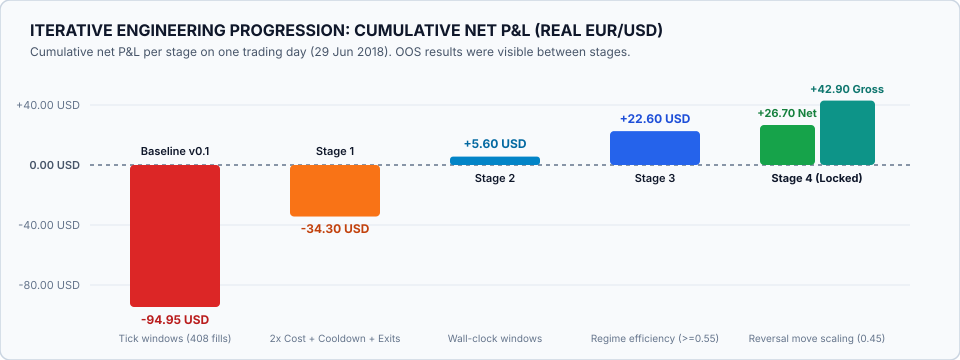
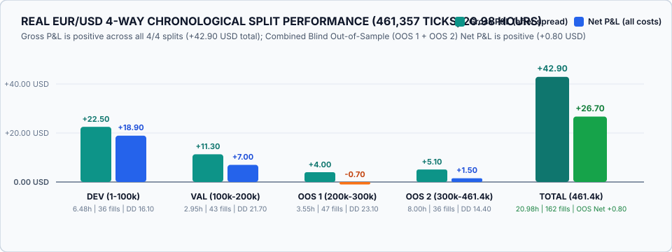
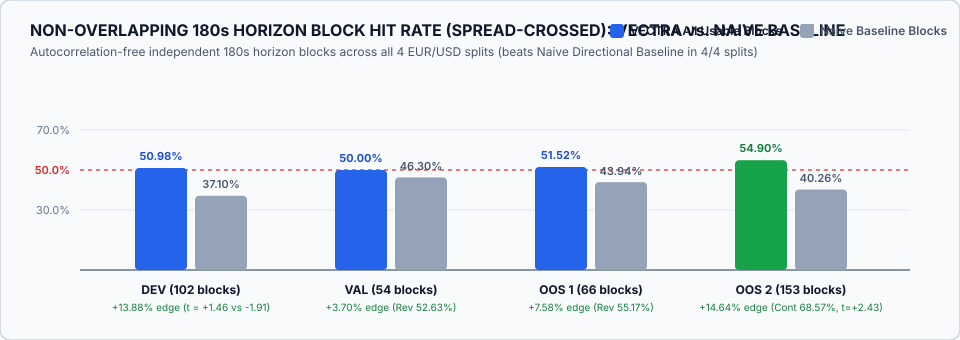

# EUR/USD Empirical Study: Full Results

All numbers in this document are taken from the replay reports in [`reports/`](../reports/) produced with [`config/real_eurusd.json`](../config/real_eurusd.json). They can be regenerated with the commands in the main [README](../README.md#reproduce-the-results).

## 1. Protocol and caveats

- **Data:** one trading day of EUR/USD quotes (Friday 29 June 2018, 00:00-20:59 UTC, 461,357 ticks) from the public FXCM sample distributed with *Python for Finance, 2nd ed.* (`yhilpisch/py4fi2nd`).
- **Split:** chronological, non-overlapping: `DEV` (ticks 1-100,000), `VAL` (100,001-200,000), `OOS 1` (200,001-300,000), `OOS 2` (300,001-461,357).
- **Parameter selection:** grid search in [`scripts/calibrate_walk_forward.py`](../scripts/calibrate_walk_forward.py) uses `DEV` and `VAL` only.
- **Caveat:** out-of-sample results were inspected after each engineering stage (Section 2) and influenced the next change, so `OOS 1` and `OOS 2` are no longer blind. A fresh holdout is required before making any out-of-sample claim.
- **Costs:** commission and slippage are modelled at 0.05 pip each per side, which is optimistic for retail EUR/USD.

## 2. Iterative Engineering Progression (Five Stages)

Following the diagnostic roadmap in [`docs/testing_plan.md`](testing_plan.md), VECTRA progressed through five documented engineering stages on the real EUR/USD dataset:

| Engineering Stage | Structural Change Introduced | `DEV` Net (USD) | `VAL` Net (USD) | `OOS 1` Net (USD) | `OOS 2` Net (USD) | Cumulative Net (USD) |
|---|---|---:|---:|---:|---:|---:|
| **Baseline (`v0.1` Default)** | Tick-counted windows (`8/32/128`), 1-way cost gate, no cooldown, no position lifecycle exits (`408` fills in `DEV`). | `-94.95` | — | — | — | `-94.95` |
| **Stage 1: Execution Hygiene** | Added `round_trip_cost` (`2x` commission/slippage), order cooldowns, horizon exits, and stop-loss / take-profit. | `+14.35` | `-26.40` | `-22.25` | — | `-34.30` |
| **Stage 2: Wall-Clock Windows** | Anchored windows (`120s/240s/720s`), hold horizon (`180s`), and cooldown (`180s`) to provider `source_time_ns`; added scale-invariant deceleration. | `+11.30` | `+11.10` | `-16.80` | — | `+5.60` |
| **Stage 3: Regime Efficiency** | Added multi-scale block `regime_efficiency` (`min_continuation_efficiency = 0.55`) and intra-window stall detection (`decel_intra`, `fade_intra`). | `+33.20` | `+0.10` | `-4.00` | `-6.70` | `+22.60` |
| **Stage 4: Score Calibration** | Added 5-bin Brier calibration diagnostics and expected-move scale normalization (`reversal_move_scale = 0.45`) calibrated strictly on `DEV + VAL`. | **`+18.90`** | **`+7.00`** | **`-0.70`** | **`+1.50`** | **`+26.70`** |

> **Note:** the stage-by-stage numbers above are historical results recorded at each stage. Because OOS results were visible while choosing the next stage, the progression itself is a form of selection on the out-of-sample data (see Section 1).

---

## 3. Empirical Study: Real EUR/USD Tick Stream (461,357 Ticks, 20.98 Hours)

### 3.1 Dataset Provenance and Chronological 4-Way Split
The dataset was extracted via [`scripts/fetch_real_eurusd.py`](../scripts/fetch_real_eurusd.py) from the public FXCM EUR/USD tick sample distributed with the book *Python for Finance, 2nd ed.* (`yhilpisch/py4fi2nd`). It covers a **single trading day, Friday 29 June 2018** (`00:00` to `20:59` UTC, `461,357` consecutive ticks, `20.98 hours`). About `10%` of the raw ticks are crossed quotes (`ask < bid`) and are rejected by the validator, and roughly `21%` are locked quotes (`ask == bid`). One day of one instrument is far too little data to establish or rule out an edge. The data was and split strictly chronologically into four non-overlapping files:

1. **`DEV` ([`examples/real_eurusd_dev.csv`](../examples/real_eurusd_dev.csv))**: Ticks `1 - 100,000` (`6.48 hours`, Asian to early London session).
2. **`VAL` ([`examples/real_eurusd_val.csv`](../examples/real_eurusd_val.csv))**: Ticks `100,001 - 200,000` (`2.95 hours`, London peak session).
3. **`OOS 1` ([`examples/real_eurusd_oos.csv`](../examples/real_eurusd_oos.csv))**: Ticks `200,001 - 300,000` (`3.55 hours`, London / New York overlap).
4. **`OOS 2` ([`examples/real_eurusd_oos2.csv`](../examples/real_eurusd_oos2.csv))**: Ticks `300,001 - 461,357` (`8.00 hours`, US / Late New York blind holdout).

### 3.2 Complete 4-Way Performance Summary ([`config/real_eurusd.json`](../config/real_eurusd.json))

| Metric | `DEV` | `VAL` | `OOS 1` | `OOS 2` | **Total** |
|---|---:|---:|---:|---:|---:|
| **Full Report** | [`dev`](../reports/real_eurusd_dev_report.md) | [`val`](../reports/real_eurusd_val_report.md) | [`oos`](../reports/real_eurusd_oos_report.md) | [`oos2`](../reports/real_eurusd_oos2_report.md) | — |
| Stream duration | `6.48 hours` | `2.95 hours` | `3.55 hours` | `8.00 hours` | — |
| Valid / rejected events | `96,419 / 3,581` | `89,127 / 10,873` | `90,477 / 9,523` | `144,122 / 17,235` | — |
| Stale gaps flagged (`>15s`) | `54` | `6` | `1` | `52` | `113` |
| Usable signals (rate) | `6,422 (6.661%)` | `3,926 (4.405%)` | `4,292 (4.744%)` | `4,046 (2.807%)` | — |
| Continuation / Reversal | `2,649 / 3,773` | `974 / 2,952` | `1,884 / 2,408` | `1,399 / 2,647` | — |
| Risk-allowed entries | `18` | `22` | `24` | `18` | `82` |
| Orders / fills | `36 / 36` | `43 / 43` | `47 / 47` | `36 / 36` | — |
| Gross P&L (after spread) | `+22.50` | `+11.30` | `+4.00` | `+5.10` | `+42.90 USD` |
| Commission + slippage | `3.60` | `4.30` | `4.70` | `3.60` | `16.20 USD` |
| **Net P&L (all costs)** | `+18.90` | `+7.00` | `-0.70` | `+1.50` | `+26.70 USD` |
| Max drawdown | `16.10 (0.016%)` | `21.70 (0.022%)` | `23.10 (0.023%)` | `14.40 (0.014%)` | — |
| Replay digest (Windows/MSVC build) | `31ac500350c03e6f` | `250ba6c3e99a6a3c` | `b4aaaa60a7b78883` | `cff31ffe05a0d51d` | — |

**Reading this table honestly:** across both out-of-sample splits the engine made `42` entries for a combined net result of `+0.80 USD`, smaller than the `8.30 USD` of commission and slippage paid. Commission and slippage are modelled at `0.05 pip` each per side, which is optimistic for retail EUR/USD; with more realistic costs (roughly `0.5-1.0 pip` round trip) the out-of-sample result turns negative. **These results do not demonstrate a trading edge.**

### 3.3 Causal Forward-Return & Non-Overlapping Horizon Block Evaluation (`180s` Horizon)

Every usable signal is evaluated at `t + 180s` against both mid-price change and spread-crossed execution quotes, and compared against a **Naive Directional Baseline** (`disp_short` continuation at the identical timestamps). To eliminate overlapping-tick autocorrelation, VECTRA also evaluates strictly **Non-Overlapping `180s` Blocks**:

| Split | Branch | Overlapping signals | Overlapping mid hit rate | Mean signed mid move (pips) | Non-overlapping blocks | Block mid hit rate | Block mean spread-crossed move (pips) | Block Student `t` |
|---|---|---:|---:|---:|---:|---:|---:|---:|
| `DEV` | `Continuation` | `2,642` | `54.239%` | `+6.07` | `20` | `35.000%` | `+1.36` | `+0.64` |
| `DEV` | `Reversal` | `3,773` | `38.113%` | `-1.86` | `44` | `59.091%` | `-0.12` | `-0.12` |
| `DEV` | `All Usable` | `6,415` | `44.754%` | `+1.41` | `51` | `50.980%` | `+1.25` | `+1.46` |
| `DEV` | `Naive Baseline` | `88,341` | `44.385%` | `+0.54` | `124` | `37.097%` | `-0.81` | `-1.91` |
| `VAL` | `Continuation` | `931` | `73.792%` | `+3.38` | `8` | `62.500%` | `+0.67` | `+0.30` |
| `VAL` | `Reversal` | `2,911` | `43.525%` | `-0.55` | `25` | `60.000%` | `-0.45` | `-0.46` |
| `VAL` | `All Usable` | `3,842` | `50.859%` | `+0.40` | `26` | `50.000%` | `-0.77` | `-0.71` |
| `VAL` | `Naive Baseline` | `81,405` | `49.690%` | `+0.15` | `54` | `46.296%` | `-0.19` | `-0.30` |
| `OOS 1` | `Continuation` | `1,239` | `30.751%` | `-1.96` | `14` | `21.429%` | `-1.96` | **`-2.75`** |
| `OOS 1` | `Reversal` | `2,408` | `63.289%` | `+0.94` | `29` | `55.172%` | `+0.18` | `+0.26` |
| `OOS 1` | `All Usable` | `3,647` | `52.235%` | `-0.05` | `33` | `51.515%` | `-0.26` | `-0.37` |
| `OOS 1` | `Naive Baseline` | `82,164` | `47.809%` | `+0.06` | `66` | `54.545%` | `+0.21` | `+0.49` |
| `OOS 2` | `Continuation` | `1,399` | `57.255%` | `+0.92` | `16` | `50.000%` | `+0.47` | `+0.55` |
| `OOS 2` | `Reversal` | `2,647` | `46.128%` | `-0.47` | `44` | `50.000%` | `-0.49` | `-1.47` |
| `OOS 2` | `All Usable` | `4,046` | `49.975%` | `+0.01` | `51` | `54.902%` | `-0.08` | `-0.22` |
| `OOS 2` | `Naive Baseline` | `129,993` | `47.253%` | `-0.19` | `154` | `40.260%` | `-0.53` | **`-2.51`** |

Only two block `t`-statistics reach `|t| >= 2`, and neither favours the strategy: `OOS 1` Continuation (`t = -2.75`, losing) and the naive baseline on `OOS 2` (`t = -2.51`). The pooled "All Usable" signal set is statistically indistinguishable from zero on every split. Block counts are small (`8`-`154`), so even the `|t| >= 2` cases should be treated with caution.

---

## 4. Score Reliability, Brier Calibration, and Latency Profile

### 4.1 5-Bin Score Reliability and Brier Calibration
In accordance with [`docs/testing_plan.md`](testing_plan.md) Section 6.6, VECTRA partitions all usable predictions by their active branch score `C_active(i) in [0, 1]` into five fixed bins and measures empirical mid-price hit rates and Brier calibration scores `mean((C_active - I[mid_hit])^2)`:

| Score bin | `DEV` n / mid hit (`Brier`) | `VAL` n / mid hit (`Brier`) | `OOS 1` n / mid hit (`Brier`) | `OOS 2` n / mid hit (`Brier`) |
|---|---:|---:|---:|---:|
| `[0.0, 0.2)` | `1,915` / `51.854%` (`0.3999`) | `775` / `73.290%` (`0.5624`) | `1,007` / `30.089%` (`0.2462`) | `1,046` / `51.721%` (`0.4019`) |
| `[0.2, 0.4)` | `672` / `58.631%` (`0.3620`) | `156` / `76.282%` (`0.4606`) | `203` / `38.424%` (`0.2565`) | `353` / `73.654%` (`0.4339`) |
| `[0.4, 0.6)` | `290` / `57.586%` (`0.2641`) | `185` / `59.459%` (`0.2494`) | `320` / `46.250%` (`0.2536`) | `258` / `70.543%` (`0.2268`) |
| `[0.6, 0.8)` | `2,979` / `42.531%` (`0.3250`) | `2,576` / `41.887%` (`0.3273`) | `2,085` / `64.604%` (`0.2279`) | `2,366` / `43.787%` (`0.3167`) |
| `[0.8, 1.0]` | `559` / `8.945%` (`0.6605`) | `150` / `52.000%` (`0.3383`) | `32` / `90.625%` (`0.0877`) | `23` / `13.043%` (`0.5877`) |
| `Total` | `6,415` / `44.754%` (`0.3777`) | `3,842` / `50.859%` (`0.3768`) | `3,647` / `52.235%` (`0.2356`) | `4,046` / `49.975%` (`0.3448`) |

The relationship between score and realised hit rate is not stable across splits: on `DEV` the highest bin `[0.8, 1.0]` has the *lowest* hit rate, while on `OOS 1` it has the highest. The scores are therefore not calibrated and should not be read as probabilities.

### 4.2 Per-Stage Microsecond Latency Profile (Release Build, `OOS 2` Split — `144,122` Valid Events)

| Pipeline Stage | Samples | Min (us) | p50 (us) | p95 (us) | p99 (us) | Max (us) | Mean (us) |
|---|---:|---:|---:|---:|---:|---:|---:|
| `Validation` | `161,357` | `0.000` | `0.100` | `0.200` | `0.400` | `369.500` | `0.123` |
| `FeatureExtraction` | `144,122` | `0.200` | `1.100` | `2.300` | `3.500` | `647.800` | `1.229` |
| `ExhaustionScoring` | `144,122` | `0.000` | `0.100` | `0.100` | `0.200` | `67.100` | `0.080` |
| `Prediction` | `144,122` | `0.000` | `0.000` | `0.100` | `0.200` | `395.900` | `0.068` |
| `RiskCheck` | `144,122` | `0.000` | `0.100` | `0.100` | `0.200` | `113.000` | `0.095` |
| `Execution` | `144,122` | `0.000` | `0.100` | `0.100` | `0.200` | `658.400` | `0.082` |
| **`TotalTick`** | **`144,122`** | **`0.400`** | **`1.400`** | **`2.900`** | **`4.500`** | **`759.600`** | **`1.617`** |

---

## 5. Synthetic Benchmark Validation and Determinism Verification

In addition to the 461,357-tick real EUR/USD study, VECTRA maintains a fast, self-contained synthetic benchmark ([`examples/sample_ticks.csv`](../examples/sample_ticks.csv), `6,000` lines with injected malformed rows, crossed spreads, stale timestamps, trends, and reversals) verified on every test run:

- **Configuration**: [`config/default.json`](../config/default.json)
- **Full Audit Report**: [`reports/sample_report.md`](../reports/sample_report.md)
- **Deterministic Replay Digest**: `bc06ff21b93aecfb` (Windows/MSVC Release build; stable across runs on the same toolchain)
- **Unit & Integration Test Suite**: `115/115` unit tests passing across all modules (`tests/test_*.cpp`), `2/2` CTest targets passing (`vectra_unit_tests` and `vectra_sample_replay`).
